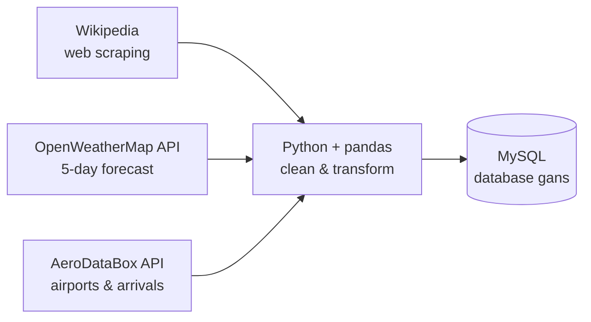
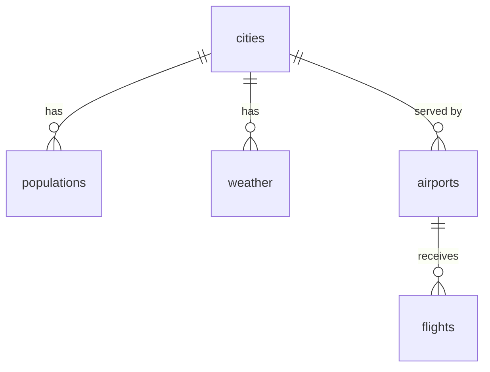

# Gans – Data Pipeline for E-Scooter Fleet Planning

An ETL pipeline that collects city, weather and flight data from the web and two APIs, cleans it with Python, and stores it in a relational MySQL database. Built during the WBS Coding School Data Analytics bootcamp.

## The business problem

Gans is a (fictional) start-up that rents out e-scooters by the minute. Its operational challenge is mundane: scooters need to be where users want them. Several things push scooters to the wrong places:

- **Weather**: when it rains, usage drops sharply.
- **Tourists**: young travellers arriving by plane need scooters downtown.
- **Daily patterns**: commuters move from residential areas to the centre in the morning.

Before Gans can build predictive models, it needs reliable, regularly updated data. This project builds that data foundation.

## What the pipeline does



| Step | Source | Method | Result |
|---|---|---|---|
| Cities & population | Wikipedia | web scraping (BeautifulSoup) | `cities`, `populations` |
| Weather | OpenWeatherMap 5-day / 3-hour forecast | REST API (requests) | `weather` |
| Airports | AeroDataBox (RapidAPI) | REST API | `airports` |
| Flights | AeroDataBox (RapidAPI) | REST API | `flights` (tomorrow's arrivals) |

The **database is the source of truth**: the weather and flight pipelines read the cities and airports from MySQL instead of using hard-coded lists. Adding a new city to the `cities` table is enough for it to be included in the next weather and flight runs.

## Database design

<!-- Add your Workbench diagram here:  -->



| Table | Content | Key decisions |
|---|---|---|
| `cities` | name, country, coordinates | coordinates stored as decimals; unique by coordinates (names can repeat) |
| `populations` | population, year of the figure, date retrieved | history is kept: each run adds rows instead of overwriting |
| `weather` | 40 forecast slots per city: temperature, feels-like, wind, rain probability, rain & snow volume | units in column names (`temperature_c`, `wind_speed_ms`, `rain_3h_mm`) |
| `airports` | ICAO / IATA codes, name, location, time zone | ICAO code as natural primary key |
| `flights` | tomorrow's arrivals: time, origin, flight number, airline, aircraft, terminal | codeshares excluded, so one row = one landing plane |

The full schema is in [`gans_database_setup.sql`](gans_database_setup.sql).

## Repository structure

```
├── 01_cities_populations.ipynb   # Wikipedia scraping -> cities, populations
├── 02_weather.ipynb              # OpenWeatherMap API -> weather
├── 03_airports_flights.ipynb     # AeroDataBox API -> airports, flights
├── gans_database_setup.sql       # CREATE statements for all tables
├── requirements.txt              # Python packages
├── .env.example                  # template for the secrets file
└── README.md
```

## How to run it

1. Create the database: run `gans_database_setup.sql` in MySQL Workbench.
2. Install the packages: `pip install -r requirements.txt`
3. Copy `.env.example` to `.env` and fill in your MySQL connection string and API keys.
4. Run the notebooks **in order**: cities first, then weather, then airports & flights. Each notebook has a dry-run cell (scrapes / calls the API without writing to the database) and a final cell that runs the pipeline.

```python
run_city_pipeline(["Berlin", "Hamburg", "Munich", "Frankfurt"])  # 01: adds only new cities
run_weather_pipeline()                                            # 02: forecasts for all cities in the DB
run_airports_pipeline()                                           # 03: airports for cities that have none yet
run_flights_pipeline()                                            # 03: tomorrow's arrivals for all airports
```
## Adding more cities

The pipeline is not limited to the four starting cities. To add a city, pass its English Wikipedia name (as it appears at the end of the URL) to the city pipeline:

```python
run_city_pipeline(["Hanover", "Düsseldorf", "Stuttgart"])
```

The other notebooks pick up new cities automatically from the database:

| Step | What happens for a new city |
|---|---|
| Weather | forecast is fetched for every city in the `cities` table |
| Airports | airports are searched **only** for cities that don't have one yet |
| Flights | arrivals are fetched for every airport in the `airports` table (2 API calls per airport) |

**Tested:** a dry run with Hanover, Düsseldorf and Stuttgart returned country, coordinates and population for all three without any code changes.

**Things to check first**
- Run the dry-run cell before writing to MySQL. Wikipedia pages outside Germany sometimes format the population differently.
- Cities closer than ~50 km to each other (e.g. Cologne and Düsseldorf) can find the same airport. In the current design, an airport belongs to the first city that found it (see *Limitations*).
- Each extra airport adds 2 API calls per flights run, so keep an eye on the RapidAPI quota.

## Challenges and how I solved them

- **Wikipedia pages are not uniform.** The population of Frankfurt was not found at first: the word "Population" also appears in the page's table of contents, which comes before the info box in the HTML. I searched only inside the info box and checked the *content* of a cell (a number like `760,656`) instead of relying on its *position*.
- **Hidden data-quality issues.** A leading space (`" Germany"`) slipped into the country column. I fixed it in SQL with `TRIM()` and at the source with `get_text(strip=True)`.
- **Coordinates as text.** Instead of converting `52°31′12″N` by hand, I used the hidden decimal coordinates Wikipedia provides in the HTML.
- **Which population figure?** Pages show census, estimate and urban-area figures. I chose the city-proper figure (consistent across pages) and stored the year it describes separately from the date I collected it.
- **Missing JSON keys.** Rain and snow amounts only appear when precipitation is forecast; some flights have no terminal or aircraft model. Using `.get()` with defaults keeps the pipeline from crashing.
- **Codeshare duplicates.** One plane is often sold under several flight numbers. With codeshares included, two airports returned about 2,800 rows for one day; without them, about 930. Excluding them avoids overestimating arrivals.
- **API limits.** The flights endpoint allows at most 12 hours per request, so each day is fetched in two windows. The airports pipeline only calls the API for cities that don't have an airport yet, to save requests on a shared key.
- **Avoiding duplicates on re-runs.** New cities and airports are compared with the database before inserting; populations, weather and flights are appended with a retrieval timestamp to build a history.
- **Keeping secrets out of the code.** Passwords and API keys live in a `.env` file that is excluded from Git via `.gitignore`.

## A first look at the data

Scheduled arrivals for 24 October 2026, collected the day before (codeshares, cargo and private flights excluded):

| City | Airport | Arrivals |
|---|---|---|
| Frankfurt | FRA | 628 |
| Munich | MUC | 446 |
| Berlin | BER | 251 |
| Hamburg | HAM | 166 |
| **Total** | | **1,491** |

More arrivals do not automatically mean more scooter users: Frankfurt is a transfer hub where many passengers never leave the airport, while Berlin's traffic is more point-to-point.

## Limitations and next steps

- Each airport is linked to one city. If nearby cities share an airport (e.g. Cologne and Bonn), a `cities_airports` bridge table would model this many-to-many relationship.
- Weather forecast times are in UTC, flight times in the airport's local time; analyses that combine them need to align time zones.
- Hilly terrain and commuting patterns (two of Gans' challenges) would need elevation data and Gans' own ride data.
- Next: move the pipeline to the cloud and schedule it to run automatically.

## Skills demonstrated

Python · pandas · web scraping (BeautifulSoup, regex) · REST APIs (requests, JSON) · data cleaning · relational database design (MySQL, primary & foreign keys) · SQLAlchemy / `to_sql` · environment variables for secrets · Git & GitHub

## Author

## Author

**Dr. Simindokht Gol Kar** – PhD chemist, now upskilling in data analytics

I spent years turning complex measurements into clear conclusions in the lab. Now I'm applying the same analytical approach to business data: collecting it, structuring it, and turning it into insights that help decision-makers make better choices.

This project was built during the Data Analytics & AI bootcamp at WBS Coding School.

[LinkedIn](https://www.linkedin.com/in/simindokhtgolkar)
